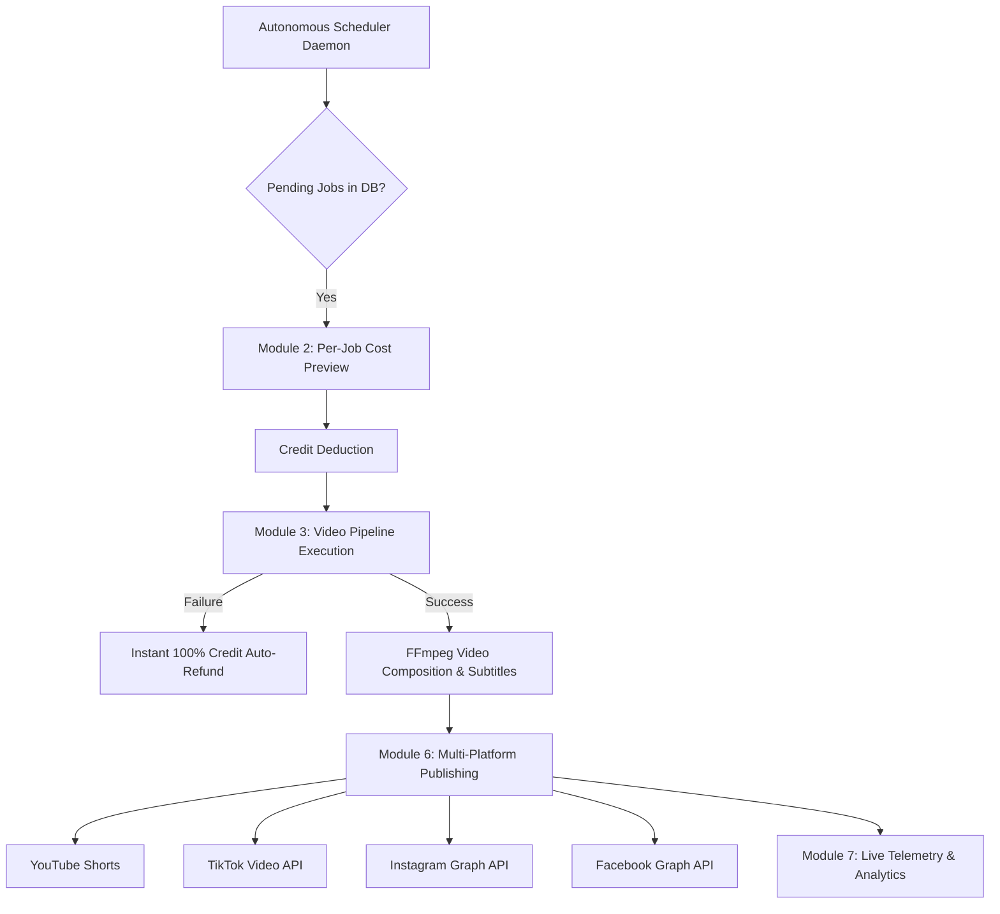

<div align="center">

# ⚡ AUTORA — Autonomous Multi-Platform AI Video SaaS

**Produce, Schedule, and Auto-Publish High-Retention Short-Form & Long-Form Video Channels with Zero Manual Editing.**

[](https://github.com/rayyan-mustafa/SAAS-Video-automation/actions/workflows/ci.yml)
[](https://nextjs.org/)
[](https://www.typescriptlang.org/)
[](https://nodejs.org/)
[](LICENSE.txt)
[](https://autora.live)
[](https://conventionalcommits.org)

<br/>

[](https://youtube.com)
[](https://tiktok.com)
[](https://instagram.com)
[](https://facebook.com)

</div>

---

## 📖 Overview

**AUTORA** (`autora.live`) is an enterprise-grade autonomous video generation and social publishing platform. It bridges generative AI scripting, multimodal video generation, neural speech synthesis, and direct social media publishing APIs into a continuous background automation engine.

From identifying viral competitor topics to generating dynamic FFmpeg video renders and auto-publishing to YouTube Shorts, TikTok, Instagram Reels, and Facebook Reels — AUTORA operates completely hands-free.

---

## 📐 Architecture & Workflow Pipeline

```text
┌─────────────────┐     ┌──────────────────┐     ┌─────────────────────┐
│ Competitor Data │ ──► │  Outlier Formula │ ──► │ Winner-Bias Calendar│
└─────────────────┘     └──────────────────┘     └─────────────────────┘
                                                            │
                                                            ▼
┌─────────────────┐     ┌──────────────────┐     ┌─────────────────────┐
│  Social Publish │ ◄── │ FFmpeg Compositor│ ◄── │ Multi-Model Video AI│
│ (YT/TT/IG/FB)   │     │ (Subtitles & Mux)│     │ (Wan/Fal/Veo/OpenAI)│
└─────────────────┘     └──────────────────┘     └─────────────────────┘
```



---

## 🚀 Core 8 Production Modules

| Module | Core Functionality | Technical Highlights |
|---|---|---|
| **1. Production Security & 2-Tier Pricing** | In-memory sliding-window rate limiter & tamper-proof auth | Constant-time HMAC SHA-256 tokens; Creator ($49/mo) & Pro ($99/mo) tiers. |
| **2. Zero-Waste Credit Ledger** | Real-time cost preview & instant automated refunds | Automatic 100% credit restoration on pipeline failure; zero wasted customer credits. |
| **3. AI Video Pipeline & Bible** | Multi-provider video routing & continuity engine | Wan 2.1, Fal.ai, OpenAI Video, Google Veo, Runway, Luma; FFmpeg libass subtitles. |
| **4. Competitor Intelligence** | Scraping viral outliers across competitor channels | Formula: `Viral Score = Views / Channel Baseline Average`; 1-click calendar sync. |
| **5. Own Channel IQ** | Historical winner-bias performance loop | YouTube Data API v3 feedback loop prioritizing high-retention hooks and topics. |
| **6. Multi-Platform Auto-Publish** | Native API publishing to 4 major video platforms | YouTube Shorts, TikTok, Instagram Reels, Facebook Reels duration & tag guards. |
| **7. Telemetry & Analytics** | Real-time observability dashboard | Precise render durations, motion distributions, error logs, and refund receipts. |
| **8. Licensed Voice & Variety** | Microsoft Edge Neural TTS & rotating frameworks | 5 storytelling frameworks avoiding repetitive AI video structure patterns. |

---

## 🛠️ Tech Stack

- **Framework**: [Next.js 14](https://nextjs.org/) (App Router, Server Actions, Dynamic API Routes)
- **Language**: [TypeScript 5.9](https://www.typescriptlang.org/) (Strict Mode)
- **Database**: [SQLite (better-sqlite3)](https://github.com/WiseLibs/better-sqlite3) & PostgreSQL adapter
- **Media Engine**: [FFmpeg](https://ffmpeg.org/) (via `@ffmpeg-installer/ffmpeg`)
- **Speech Synthesis**: [Microsoft Edge Neural TTS](https://github.com/schroffl/msedge-tts)
- **Payments & Billing**: [Polar.sh](https://polar.sh/) & [Stripe](https://stripe.com/)
- **Social APIs**: YouTube Data API v3, TikTok Video API, Meta Graph API (Instagram & Facebook)
- **CI / CD**: GitHub Actions, Docker, Husky, Commitlint

---

## ⚡ Getting Started

### Prerequisites
- **Node.js**: `v20.x` or `v22.x`
- **npm**: `v10.x` or newer
- **FFmpeg**: Handled automatically via `@ffmpeg-installer/ffmpeg`

### 1. Clone the Repository
```bash
git clone https://github.com/rayyan-mustafa/SAAS-Video-automation.git
cd SAAS-Video-automation
```

### 2. Install Dependencies
```bash
npm install
```

### 3. Configure Environment Variables
Copy the environment template and populate your API credentials:
```bash
cp .env.example .env
```

Key environment variables:
```env
# Application Secrets
ADMIN_SECRET="your-32-char-min-admin-secret"
JWT_SECRET="your-32-char-min-jwt-secret"
ENCRYPTION_KEY="your-32-char-min-encryption-key"
ADMIN_USER="autora_admin"
ADMIN_PASSWORD="YourStrongPassword123!"

# AI Video & Speech Providers
GEMINI_API_KEY="your-google-gemini-key"
OPENAI_API_KEY="your-openai-key"
FAL_KEY="your-fal-ai-key"

# Billing & Monetization
POLAR_ACCESS_TOKEN="polar_at_..."
POLAR_WEBHOOK_SECRET="whsec_..."
```

### 4. Run Development Server
```bash
npm run dev
```
Open [http://localhost:3000](http://localhost:3000) to view the application.

---

## 🧪 Testing & Verification

The project includes unit, regression, security, and real-browser QA suites:

```bash
# Static TypeScript Type Checking
npm run typecheck

# Execute Master Modules 1 Through 8 Test Suite
npm run test:unit

# Run Production Regression Audit
npm run test:audit

# Validate Next.js Production Build
npm run build
```

---

## 🐳 Docker Deployment

You can build and deploy AUTORA as a lightweight Docker container:

```bash
# Build Docker image
docker build -t autora-saas .

# Run Docker container
docker run -p 3000:3000 --env-file .env autora-saas
```

---

## 🏢 Turnkey Commercial SaaS Architecture & Asset Overview

AUTORA is engineered as an enterprise-grade, turn-key Software-as-a-Service (SaaS) business asset:

| Component | Architecture & Valuation Highlights |
|---|---|
| **Multi-Tier Subscription Monetization** | Creator Plan ($49/mo, 100 credits) and Pro Plan ($99/mo, 250 credits) with automated Polar/Stripe webhooks and dynamic per-job cost calculation. |
| **Zero-Waste Auto-Refund Engine** | Automated 100% credit restoration on pipeline error with structured ledger transaction auditing. |
| **Multi-Provider AI Routing** | Pluggable failover pipeline supporting Wan 2.1, Fal.ai, OpenAI Video, Google Veo, Runway, and Luma with edge neural voice synthesis. |
| **Omni-Channel Direct Publishing** | Direct API integrations with YouTube Data API v3, TikTok Video API, Instagram Graph API, and Facebook Graph API with duration guards. |
| **Enterprise Security Posture** | In-memory sliding-window IP rate limiters, constant-time HMAC SHA-256 admin tokens, and AES-256-GCM encrypted credential vault. |

---

## 🤝 Internal Engineering & Contribution Standards

Authorized team members, contributors, and maintaining engineers must adhere to our internal development protocols:

- Review [agents.md](agents.md) for architecture rules, canonical scopes, and testing mandates.
- All commits must strictly conform to [Conventional Commits](https://www.conventionalcommits.org/).
- PRs must satisfy the checklist in [.github/pull_request_template.md](.github/pull_request_template.md).

---

## 🛡️ Security & Responsible Disclosure

For internal security guidelines and responsible disclosure procedures, please refer to [SECURITY.md](SECURITY.md).

---

## 📄 Proprietary License & Acquisition Terms

- **Proprietary Software**: Copyright (c) 2026 Rayyan Mustafa. All Rights Reserved. This software is proprietary and confidential. Unauthorized copying, distribution, decompilation, public disclosure, or resale is strictly prohibited.
- **Acquisition Transferability**: In the event of an authorized asset purchase or business acquisition, full exclusive ownership, intellectual property rights, database schemas, and operational assets transfer to the acquiring entity per the definitive purchase agreement. See [LICENSE.txt](LICENSE.txt) for full legal terms.


